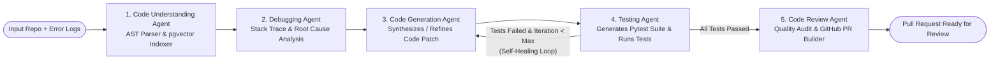

# AI Software Engineering Agent

An autonomous **5-Agent Software Engineering System** built with **Python + FastAPI**, **LangGraph**, **PostgreSQL + pgvector**, **Gemini API / OpenAI API** (plus an offline AST + Heuristic Self-Healing Engine), **React**, and **Docker**.

---

## Core Capabilities

1. **Accepts a GitHub Repository or Local Codebase**: Supports GitHub URLs (`https://github.com/owner/repo`), local filesystem paths, and 2 built-in buggy repositories (`sample:ecommerce_checkout_bug` and `sample:async_task_queue_bug`).
2. **Understands Code Structure & Semantic Vectors**: Parses Python ASTs to extract classes, methods, functions, imports, and static bug smells, then chunks and indexes embeddings into **PostgreSQL + `pgvector`** (with automatic fallback to local SQLite + cosine similarity vector store when running without Docker).
3. **Reads Error Logs & Finds Root Causes**: Correlates stack traces, issue descriptions, AST warnings, and vector-retrieved symbols to pinpoint exact file and line defects.
4. **Generates Code Fixes & Unit Tests**: Synthesizes unified code diffs and comprehensive `pytest` regression suites.
5. **Self-Healing Iterative Test Loop**: Executes `pytest` inside an isolated workspace, inspects test failure tracebacks, routes failures back to the **Code Generation Agent** to refine its proposed patch, and re-runs `pytest` until all tests pass.
6. **Automated Code Review & Pull Request Creation**: Audits the final diff for correctness, boundary safety, and security, then constructs a Pull Request (and optionally opens a live GitHub PR via REST API when a `GITHUB_TOKEN` is supplied).

---

## Multi-Agent LangGraph Architecture



---

## Quick Start

### Option 1: Full Stack with Docker Compose (`PostgreSQL + pgvector`, `FastAPI`, `React`)

```bash
docker compose up --build
```

- **React Dashboard**: http://localhost:5173
- **FastAPI Backend & Swagger Docs**: http://localhost:8000/docs

### Option 2: Run Unified Full-Stack Server Locally (Frontend + Backend Merged on Port 8000)

#### 1. Start the Merged Full-Stack App (`FastAPI` + `Frontend UI` on `http://localhost:8000`)
```bash
python run.py
```
Open **http://localhost:8000** in your browser to access the interactive 5-Agent Dashboard, or **http://localhost:8000/docs** for the OpenAPI documentation.

#### 2. Run via CLI (`backend/cli.py`)
```bash
cd backend
python cli.py --repo sample:ecommerce_checkout_bug
python cli.py --repo sample:async_task_queue_bug
python cli.py --repo sample:graph_shortest_path_bug
```

#### 3. Run Automated Self-Healing Pipeline Tests (`pytest`)
```bash
cd backend
python -m pytest tests -v
```

#### 4. Start the Frontend (`React + Vite`)
```bash
cd frontend
npm install
npm run dev
```
Open http://localhost:5173 in your browser.

